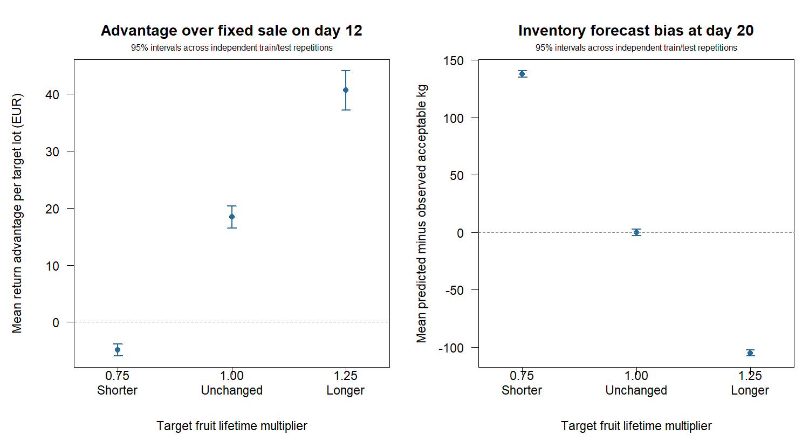

# Scientific synthesis: when should a heterogeneous orange lot be sold?

**Status:** completed synthetic-methods case study; **not** an empirically
validated sale recommendation. This synthesis uses the committed results of
prespecified R simulations. It does not combine results from distinct
experiments into a single estimated treatment effect, and it does not select
a winning policy by looking at held-out outcomes.

## Abstract

An orange lot can contain fruit with different commercial shelf lives, even
when all fruit were harvested on the same day. The question is whether
representative inspections, historical deterioration models and forecast
prices can improve the decision to sell now or keep the lot in storage.

We developed a reproducible, base-R decision model with maturity-stratified
Weibull commercial-survival curves, delivery rejection, storage costs and
optional inspection. Separate synthetic experiments examine forecast error,
hazard shifts, imperfect grading, model choice, destructive sampling,
historical-data reuse and adaptive inspection. They report paired realised
returns and, where appropriate, held-out prediction scores and uncertainty
intervals. The results do **not** identify one universally optimal sale day or
policy. A strategy that adds value under accurate prices and stable shelf
life can lose money under adverse conditions. More inspections or a more
accurate predictive model need not produce a better economic decision.

## 1. Decision problem and economic mechanism

The decision applies to **initially fresh-market-eligible** strata. Oranges
are non-climacteric; initially immature fruit are not assumed to ripen to
commercial eligibility in storage. Commercial acceptance at delivery is
distinct from food safety. The decision is about expected *net sale value*,
not about keeping every fruit edible for as long as possible.

For initial eligible mass \(M_g\), commercial survival probability \(S_g\),
forecast selling price \(p_g\), delivery lag \(L\), holding cost \(c\) per
initial kg/day, and current decision day \(d_0\), the illustrative common-sale
objective is

\[
\widehat V(d\mid d_0)
=\sum_{g\in\mathcal E}M_g\widehat S_g(d+L)\widehat p_g(d)
-c\sum_{g\in\mathcal E}M_g(d-d_0+L),\quad d\ge d_0.
\]

Holding until a candidate later sale day is preferable to selling now only
if its forecast **incremental net value** is positive: the price opportunity
must outweigh expected quality loss and extra holding cost over that interval.
A future price jump can make a later date optimal even if an intermediate day
has lower fitted value. This calculation is conditional on the supplied
price and deterioration models; its fitted optimum is not an observed or
guaranteed profit. When inspection removes fruit, the remaining inventory
and actual sampling costs must be used instead (see
[removal accounting](INSPECTION_REMOVALS.md)).

## 2. Evidence and study boundaries

- The experiments use seeded **synthetic** lots, typically 850 kg of eligible
  fruit plus 150 kg of initially immature fruit excluded from fresh-market
  revenue. Many studies use a two-day delivery lag and fixed hypothetical
  prices and costs; exact settings vary and are documented per experiment.
- Returns are assessed on common fruit outcomes and prices within a paired
  comparison. Confidence intervals generally resample whole simulated lots;
  historical-archive studies instead resample independent **train/test
  repetitions**, preserving shared lots and scenarios.
- The following numbers are from **different generators and evaluation
  panels**. Their returns must not be subtracted across rows or interpreted
  as one joint factorial experiment. Quoted intervals are marginal 95%
  percentile intervals without multiplicity adjustment, not field forecasts.
- Newer one-step adaptive policies, imperfect-label adaptive policies,
  calibration grids, grid-resolution studies and the Gaussian-quadrature
  reference have documented algorithms and CI-tested report generators.
  Their full-run numeric summaries are **not** committed as benchmark
  evidence; no quantitative superiority claim for those extensions is made
  here. See [adaptive inspection](ADAPTIVE_POLICY.md) and the
  [quadrature reference](ADAPTIVE_GAUSS_REFERENCE.md).

## 3. What the saved experiments actually show

All EUR figures below refer to **mean simulated net return differences per
eligible lot**, except the explicitly labelled prediction and inventory
metrics. “Day 12” is the prespecified no-inspection sale benchmark, not an
oracle sale date. Each citation leads to the exact saved report and its
reproduction settings.

| Dimension | Comparison and observed result | What it supports, and what it does not |
| --- | --- | --- |
| Price forecast reliability | With perfect prices, the stratified policy beats day-12 sale by **EUR 13.95** [8.57, 19.74]; with a 40%-lower terminal mean price, it trails by **EUR 29.15** [-38.76, -20.84]. [Price sensitivity](results/price_sensitivity/RESULTS.md) | Waiting can pay when forecast prices materialise; the advantage can reverse when future prices fall. |
| Finite price-scenario minimax regret | Under a 40%-lower price scenario, minimax earns **EUR 17.96** [11.99, 24.41] more than the forecast-only stratified rule, but **EUR 8.75 less** than day-12 sale [-13.52, -4.00]. Under a 20%-higher price, minimax trails the forecast-only rule by **EUR 13.08** [-19.70, -7.03]. [Price robustness](results/robust_policy/RESULTS.md) | A risk-aware date trades upside for resistance to an assumed downside; robust does **not** mean profitable in every scenario. |
| Unanticipated deterioration after cutoff | With unchanged hazards, stratified beats day-12 sale by **EUR 9.68** [3.91, 15.38]. With double post-cutoff hazard, it trails by **EUR 29.85** [-38.64, -22.33]; its quality forecast overpredicts acceptance by 12.10 percentage points on average. [Hazard stress](results/survival_stress/RESULTS.md) | Shelf-life misspecification can reverse the economic recommendation even when training data were handled correctly. |
| Shift in fresh-lot shelf life | A frozen historical policy beats day-12 sale by **EUR 18.50** [16.47, 20.35] without shift, but trails by **EUR 4.86** [-5.95, -3.85] when target lifetimes shorten 25%; day-16 acceptable inventory is then overpredicted by **137.44 kg** [134.55, 140.34]. [Historical shift](results/historical_shift/RESULTS.md) | Transferability between harvests matters as much as in-sample fit. These shocks are assumed, not measured. |
| Inspection-label error | With sensitivity = specificity = 0.90, calibrated fitting outperforms naive fitting by **EUR 48.32** [37.74, 59.24], yet its advantage over day-12 sale is only **EUR 0.12** [-5.44, 5.02]. Corrected mean Brier score is **worse** than naive (0.2271 vs 0.2181). [Grading error](results/inspection_error/RESULTS.md) | Correcting measurement error can change dates and returns without improving every predictive score or beating the operational baseline. |
| Destructive inspection costs | With EUR 0.02 per check, fixed plans of 240, 720 and 1,440 destructive checks trail no-inspection day-12 sale by **EUR 41.09**, **95.07** and **184.30**, respectively (each interval entirely negative). [Inspection-plan economics](results/inspection_plan_value/RESULTS.md) | Representative sampling is not automatically worth the fruit removed; this does not reject cheaper or nondestructive inspections. |
| Frozen historical model | With one 100-lot synthetic training archive and no target inspections, the historical policy beats day-12 sale by **EUR 20.31** [15.10, 26.51]. Across independently repeated archives, increasing training size from 10 to 100 lots adds **EUR 1.00** [0.37, 1.82] per target lot, **excluding data-acquisition costs**. [Historical baseline](results/historical_baseline/RESULTS.md); [archive uncertainty](results/archive_uncertainty/RESULTS.md) | Prior harvests can support decisions in a stationary regime; the modest incremental gain does not establish that acquiring a larger archive is economical. |
| Survival-model pooling and averaging | Shared-shape fitting improves mean Brier score versus separate fits in all three simulated shape regimes. The AIC-weighted ensemble has **higher** Brier score than the shared-shape model in all three of its regimes; in the common-shape setting, its realised return is **EUR 3.93 lower** than shared shape [-7.74, -0.18]. [Shared shape](results/shared_shape/RESULTS.md); [ensemble](results/shape_ensemble/RESULTS.md) | More flexible fitting or averaging is not guaranteed to improve either prediction or profit. |
| Minimax regret over shelf-life scenarios | For target lifetime factor 0.75, the robust survival policy earns **EUR 0.82 less** than the historical rule [-0.97, -0.65]; at factor 1.25 it earns **EUR 0.77 more** [0.63, 0.90]. [Survival regret](results/survival_regret/RESULTS.md) | Lower *fitted* worst regret does not imply better *realised* return under every true deterioration regime. |



These are contrasts against **specified competitors**, not estimates of the
value of deploying the entire pipeline. In particular, the historical-policy
comparison with destructive sampling changes both decision information and
physical inventory; it cannot isolate a predictive advantage. The
[nondestructive inspection-budget study](results/inspection_budget/RESULTS.md)
also shows that improved Brier scores from larger samples need not cover
their additional hypothetical labour costs.

## 4. Decision rule suggested for an *evaluation*, not deployment

The evidence favours a **conditional decision protocol**, not a universal
“sell on day N” rule:

1. **Define eligibility at harvest.** Separate initially immature fruit and
   establish independent, market-specific acceptance standards. Never infer
   later commercial maturity from rind colour or stored time alone.
2. **Estimate delivered acceptable mass and its uncertainty.** Fit a
   pre-decision deterioration model per relevant stratum or an explicitly
   compared pooled/shared-shape alternative. Correct for grading error only
   when reference calibration is available, and propagate calibration
   uncertainty where consequential.
3. **Compare sale now with each admissible future date.** Include the price
   expected on the selling day, the chance of rejection at delivery, holding
   costs, sorting costs, removals and any buyer capacity. Sunk past costs
   do not change the ranking of future dates if identical for every option.
4. **Stress the decision before trusting it.** Recompute the chosen date under
   plausible lower realised prices, shorter shelf life, grading error and
   realistic delivery delays. A different optimal date across plausible
   scenarios is a reason to report uncertainty, not hide it behind an average.
5. **Inspect again only when it has positive expected decision value.**
   Compare an immediate commitment with the full contingent inspection
   policy, charging labour and lost fruit once. The [adaptive policy](ADAPTIVE_POLICY.md)
   formalises this comparison; neither its finite scenario prior nor its
   current numerical calibration study has been validated in a field trial.
6. **Retain a transparent conservative comparator.** Day-12 sale is the
   prespecified baseline in the simulations, not a recommended real-world
   date. A future field trial must set its own status-quo benchmark before
   outcomes arrive and report negative policy gains.

There is no defensible way to infer an actual selling date for a grower from
the example's seeded Weibull parameters and fictional price paths alone.

## 5. What remains unknown

1. **External validity:** no independently collected orchard/warehouse data,
   measured commercial loss curve or historical market price forecast errors.
2. **Observation validity:** possible correlated grading errors, imperfect
   “gold-standard” labels, nonrandom fruit sampling, selection into grades
   and mass-dependent deterioration.
3. **Operations:** handling and transport damage, delivery delays, buyer
   capacities, real inspection labour, disposal/processing revenue, inventory
   financing and environmental storage controls.
4. **Joint uncertainty:** most saved studies vary one mechanism while holding
   others fixed. Stress results cannot be combined into a calibrated joint
   distribution of price, survival, grader accuracy and operating costs.
5. **Prospective performance:** no harvest-lot-level field holdout, calibration
   coverage, measured return uplift or cost-effectiveness trial. Marginal
   simulated intervals do not quantify these external uncertainties.

The [prospective measurement protocol](PROTOCOL.md) specifies the required
data, temporal boundaries and release criteria. A valid empirical claim needs
multiple independent harvest lots, prespecified lot-level splits and
operational benchmarks, an auditable cost ledger, calibrated held-out quality
predictions and transparently reported negative effects. Until then, this
project remains **unfeatured** in the portfolio.

## 6. Reproduction and evidence map

This synthesis is a reading guide to **committed R outputs**, not a new
experiment. Each linked `RESULTS.md` reports its own sample size, random
seed/settings file, estimator, comparator and reproducibility command.
Underlying CSV records, plots and settings are tracked for the saved studies.
Run from `projects/orange_storage_decision` with base R, for example:

```sh
Rscript tests/test_model.R
Rscript scripts/run_price_sensitivity.R 200
Rscript scripts/run_inspection_plan_value.R 200
Rscript scripts/run_historical_shift.R 30 results/historical_shift 50
```

The full project CI tests the survival models, deterministic synthetic
experiments and all documented adaptive extensions; report smoke tests do
not imply a large Monte Carlo study has been archived for every extension.
For model-specific methods and other saved results, use the
[project README](README.md). The next step for this portfolio artifact is a
final documentation/reproducibility audit, **not** another optimisation
method. A real-data field study would be a distinct research phase.

## Conclusion

Optimal sale timing is an **economic decision under deterioration and price
uncertainty**. Fitting a plausible quality curve is necessary but insufficient:
price bias, changing storage conditions, inspection error and the cost of
acquiring information can each reverse the apparent gain from waiting.
The practical contribution of this R case study is a tested framework for
making those assumptions and trade-offs explicit, while preserving negative
results and avoiding unsupported claims about actual orange sales.
