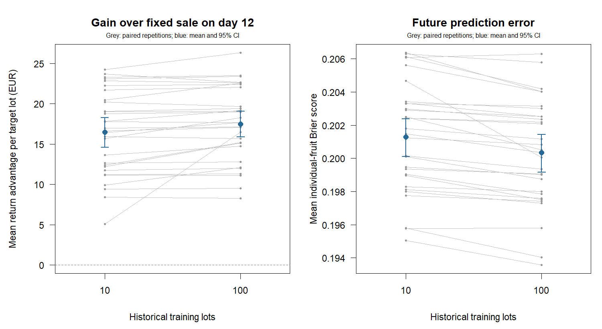

# Uncertainty across historical training archives

30 independent train/test repetitions, each with 50 fresh target lots.
Each repetition fits models on 10 and 100 historical lots; the smaller
archive is the first 10 lots of the larger archive. Both frozen policies
evaluate the same target fruit and price paths, without target inspections.
There are 1500 unique target lots and 3000 paired policy/target records.

## Expected deployment performance

Intervals resample entire train/test repetitions, including archive variation.
They describe the mean of the training-and-deployment procedure under the
fixed synthetic regime, not the performance range of a particular archive
or an individual target lot. No target row is resampled independently.

| Metric | Historical lots | Mean [95% CI] | SD across repetition means |
|---|---:|---:|---:|
| Return (EUR/lot) | 10 | 490.05 [487.69, 492.57] | 6.93 |
| Return (EUR/lot) | 100 | 491.05 [488.57, 493.37] | 6.82 |
| Gain vs day 12 (EUR/lot) | 10 | 16.47 [14.58, 18.29] | 5.19 |
| Gain vs day 12 (EUR/lot) | 100 | 17.47 [15.88, 19.06] | 4.62 |
| Gain vs day 16 (EUR/lot) | 10 | 40.28 [37.69, 42.60] | 6.91 |
| Gain vs day 16 (EUR/lot) | 100 | 41.28 [39.32, 43.20] | 5.58 |
| Brier score | 10 | 0.20129 [0.20009, 0.20239] | 0.00328 |
| Brier score | 100 | 0.20035 [0.19917, 0.20144] | 0.00323 |
| Log loss | 10 | 0.59000 [0.58747, 0.59251] | 0.00738 |
| Log loss | 100 | 0.58766 [0.58512, 0.59003] | 0.00718 |
| Day 16 inventory bias (kg) | 10 | 0.82 [-5.67, 7.29] | 19.08 |
| Day 16 inventory bias (kg) | 100 | 1.42 [-0.83, 3.50] | 6.34 |
| Day 20 inventory bias (kg) | 10 | -1.14 [-8.29, 6.34] | 20.29 |
| Day 20 inventory bias (kg) | 100 | 0.85 [-1.28, 3.09] | 6.06 |
| Day 24 inventory bias (kg) | 10 | -3.45 [-10.69, 3.86] | 21.85 |
| Day 24 inventory bias (kg) | 100 | -0.59 [-2.74, 1.67] | 6.42 |

## Paired effect of using 100 instead of 10 historical lots

All contrasts are **100 minus 10**. Positive return differences favour the
larger archive; negative Brier/log-loss differences favour it. Signed bias
differences are not improvements by themselves: zero absolute bias is ideal.

| Metric | Paired mean difference [95% CI] |
|---|---:|
| Return (EUR/lot) | 1.00 [0.37, 1.82] |
| Gain vs day 12 (EUR/lot) | 1.00 [0.35, 1.89] |
| Gain vs day 16 (EUR/lot) | 1.00 [0.35, 1.89] |
| Brier score | -0.00095 [-0.00131, -0.00065] |
| Log loss | -0.00234 [-0.00323, -0.00162] |
| Day 16 inventory bias (kg) | 0.59 [-4.45, 5.64] |
| Day 20 inventory bias (kg) | 1.99 [-3.61, 7.58] |
| Day 24 inventory bias (kg) | 2.86 [-3.54, 9.35] |



## Scope and reproduction

Each archive has six ages, two strata and 60 checks per stratum/age/lot:
7,200 checks for 10 lots versus 72,000 for 100. Known grading sensitivity
and specificity are both 0.90. Training is complete before target harvest;
all target sale dates are fixed before target fruit outcomes are generated.

Every target retains 850 kg of initially eligible fruit. Returns include
holding from harvest through delivery, at EUR 0.001/kg/day with a two-day
delivery lag and known supplied prices. Fixed-date comparators retain the
same fruit. Archive collection, destructive losses, labour and model-development
costs are excluded; this is not an economic recommendation to buy more data.

Brier/log loss use individual-fruit outcomes and initial mass weights, then
average equally across ages 16, 20 and 24 and target lots. Inventory bias is
predicted minus observed acceptable kg. Repeated future scores stay within
their target and repetition. Standard deviations mix training variation with
finite-target-panel variation; this study does not separate those components.

The working marginal Weibull family and both archive sizes were fixed before
evaluation. More data cannot remove its possible misspecification. History
and targets share one synthetic regime; field validation, distribution shift,
uncertain grading accuracy and uncertain prices remain open. The percentile
95% intervals are marginal, based on 2,000 repetition resamples, without
multiplicity correction. The number of independent units is the repetition
count, not the number of target fruit or policy records.

```sh
Rscript scripts/run_archive_uncertainty.R 30 results/archive_uncertainty 50
```

[Seeds](seeds.csv) reconstruct every full historical archive and fresh target
panel. [Aggregated training counts](counts.csv) are sufficient to reconstruct
the [fitted curves](fits.csv); they are not the individual historical-lot data.
[Target records](records.csv), [repetition means](repetitions.csv),
[performance intervals](summary.csv), [paired contrasts](comparisons.csv) and
[settings](settings.R) preserve the calculations. See
[ARCHIVE_UNCERTAINTY.md](../../ARCHIVE_UNCERTAINTY.md) for the protocol and API.
