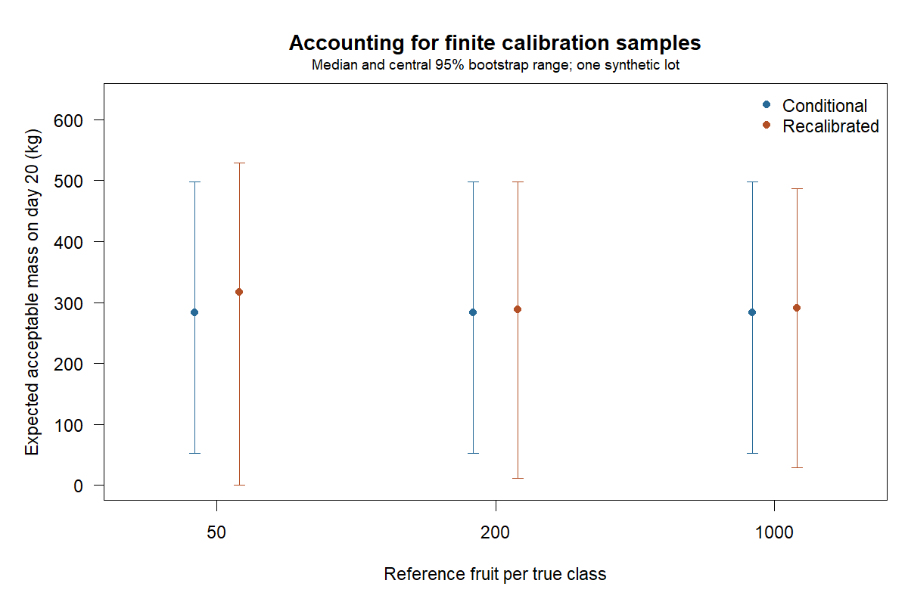

# Finite inspection calibration: bootstrap demonstration

One synthetic 850-kg eligible lot, with 150 kg of initially immature fruit excluded.
Calibration tables are constructed to have 90% sensitivity and specificity
at every sample size. They are not sampled validation datasets. This isolates
the effect of reference sample size while holding the fitted decision fixed.

Point estimate: sell on day 12; 293.7 kg acceptable on fixed day 20.

## Bootstrap distributions

500 attempts per method and calibration size; percentiles use successful refits.
Conditional holds estimated inspection rates fixed. Recalibrated also resamples
independent reference counts and re-estimates the rates before refitting.

| Reference fruit per true class | Method | Successful / attempted | Sale day median [2.5%, 97.5%] | Day-20 acceptable kg median [2.5%, 97.5%] | Mass interval width (kg) |
|---:|---|---:|---:|---:|---:|
| 50 | conditional | 500 / 500 | 12 [12, 28] | 283.2 [52.5, 498.0] | 445.4 |
| 50 | recalibrated | 500 / 500 | 12 [12, 28] | 317.0 [0.2, 528.5] | 528.2 |
| 200 | conditional | 500 / 500 | 12 [12, 28] | 283.2 [52.5, 498.0] | 445.4 |
| 200 | recalibrated | 500 / 500 | 12 [12, 28] | 288.2 [11.5, 497.4] | 486.0 |
| 1000 | conditional | 500 / 500 | 12 [12, 28] | 283.2 [52.5, 498.0] | 445.4 |
| 1000 | recalibrated | 500 / 500 | 12 [12, 28] | 291.4 [28.5, 486.8] | 458.3 |



## Interpretation

These distributions describe parameter and decision uncertainty under a fitted
Weibull model and a fixed price path. They are not predictive intervals for
realised fruit mass, confidence sets for an optimal day, or profitability evidence.
Coverage has not been established across independent lots. A larger calibration
sample need not narrow every estimated interval in a finite bootstrap run.

Recorded failures: 0 uninformative calibration draws and 0 fit failures.
Failures remain in draws.csv; no replacements are drawn. Failed replicates can
make successful-only percentiles selective. Reference errors, rate drift and
dependence between reference and storage samples are not modeled.

The plug-in binomial bootstrap is degenerate when an observed reference class
has no errors or no correct labels. A finite perfect reference sample does not
establish perfect inspection accuracy; boundary cases need another uncertainty method.

## Reproduction

```sh
Rscript scripts/run_calibration_uncertainty.R 500
```

[Draws](draws.csv), [summary](summary.csv), [point estimates](point_estimates.csv),
[reference counts](calibration_counts.csv), [reported inspections](reported_inspections.csv),
[inventory](inventory.csv), [generating truth](generating_truth.csv),
[prices](prices.csv) and [settings](settings.R) preserve the complete synthetic example.
See [CALIBRATION.md](../../CALIBRATION.md) for the two-sample bootstrap and data contract.
