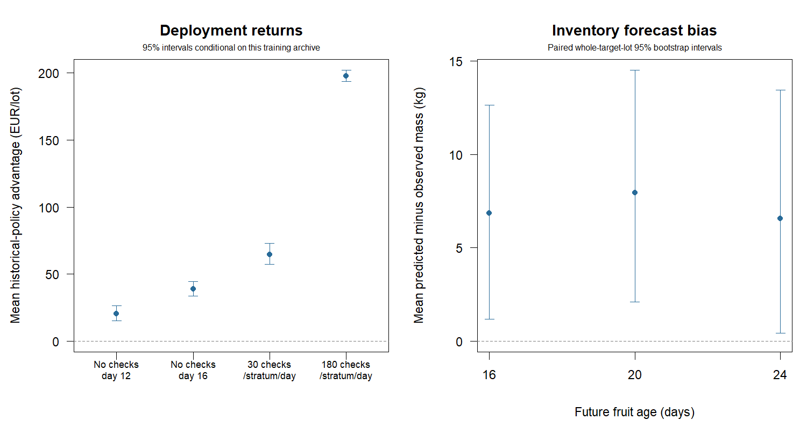

# A frozen historical survival baseline

Fit once on 100 independent historical lots; evaluate on 200 fresh target lots without refitting or tuning.
The historical policy uses initial grade masses and the supplied price path,
retains all 850 kg of eligible target fruit and performs no target inspections.
The archive contains 72,000 reported checks, with known sensitivity/specificity
of 0.90. All archive observations were available before the target harvest.

The frozen policy sells on mean day 14.66 and earns mean EUR 495.44 per target lot.

## Paired target-lot returns

All returns include eligible holding costs from harvest through delivery.
Destructive comparators pay EUR 0.02 per check and lose the actual sampled
fruit; the historical and fixed-date policies keep the full population.

| Comparator | Mean comparator EUR | Historical minus comparator EUR [95% CI] | Historical below comparator |
|---|---:|---:|---:|
| No inspection, day 12 | 475.14 | +20.31 [+15.10, +26.51] | 8.0% |
| No inspection, day 16 | 456.49 | +38.96 [+33.43, +44.55] | 12.5% |
| Destructive, 30/stratum/day | 430.90 | +64.55 [+57.09, +72.75] | 1.0% |
| Destructive, 180/stratum/day | 297.64 | +197.80 [+193.83, +202.10] | 0.0% |

## Future inventory forecasts

Predictions concern true acceptance, not noisy grading labels. Scores use
individual-fruit Brier/log loss, standardised to initial eligible inventory.
The same uninspected target fruit are assessed on each future day; intervals
resample whole target lots and do not treat repeated assessments as independent.

| Fruit age | Predicted kg | Observed acceptable kg | Bias kg [95% CI] | Brier | Log loss |
|---|---:|---:|---:|---:|---:|
| 16 | 560.88 | 554.04 | +6.84 [+1.18, +12.64] | 0.1989 | 0.5840 |
| 20 | 458.05 | 450.10 | +7.95 [+2.09, +14.51] | 0.2043 | 0.5987 |
| 24 | 368.93 | 362.37 | +6.56 [+0.42, +13.45] | 0.1909 | 0.5649 |



## Interpretation and reproduction

This is a working marginal Weibull fit per stratum, not a hierarchical model
or an estimate of a particular target lot's latent deterioration curve.
Historical and target lots share the same synthetic generating regime.
Historical IDs and calendar availability are checked; all historical-policy
dates are fixed before target fruit outcomes are generated.

The archive is assumed already available. Its collection, destructive losses,
labour and model-development costs are excluded. These deployment comparisons
do not establish whether acquiring this archive pays for itself. Predictive
and return intervals condition on this one frozen archive; uncertainty across
alternative training archives and distribution shifts is not included.

Return contrasts against destructive plans combine timing and physical
sampling costs; they do not establish superior predictive accuracy over
per-lot fits. Positive returns can coexist with biased inventory forecasts.

All intervals are marginal whole-lot percentile 95% intervals, without
multiple-comparison adjustment. Aggregate inventory bias does not establish
stratum-specific calibration or field performance. Prices and grading accuracy
are assumed known; handling damage, dependence and real operational costs
remain outside the model. No model or policy was selected using these targets.

```sh
Rscript scripts/run_historical_baseline.R 200
```

[Historical counts](history.csv), [fitted curves](fits.csv), [paired returns](records.csv),
[future measurements](forecasts.csv), [return summary](return_summary.csv),
[forecast summary](forecast_summary.csv) and [settings](settings.R) preserve the evidence.
See [HISTORICAL_BASELINE.md](../../HISTORICAL_BASELINE.md) for the data contract and protocol.
