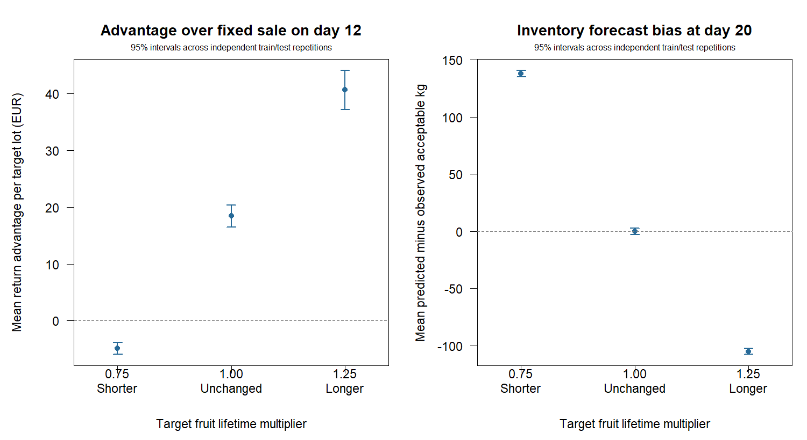

# A frozen historical model under shelf-life shift

30 independent train/test repetitions; 100 historical and 50 fresh target lots per repetition.
Each target's fruit lifetimes are multiplied by 0.75, 1 or 1.25 from harvest:
25% shorter, unchanged or 25% longer shelf life. Historical data stay unchanged.
Both initially eligible strata share the multiplier; Weibull shapes stay fixed.
These are declared stress scenarios, not estimated probabilities of future shifts.

The 1500 unique target lots produce 4500 paired target/scenario records.
The model, all sale dates and all predicted masses are frozen before target
fruit outcomes. The policy receives no shift indicator or target inspection.

## Expected deployment performance

Values are means with marginal 95% percentile intervals. Entire independent
train/test repetitions are resampled, keeping all target scenarios paired.
Intervals include training-archive and finite-target-panel variation; they
concern expected performance, not the outcome range of an individual lot.

| Metric | 25% shorter | Unchanged | 25% longer |
|---|---:|---:|---:|
| Return (EUR/lot) | 364.19 [361.27, 367.22] | 491.19 [488.14, 494.17] | 576.03 [572.06, 579.87] |
| Gain vs day 12 (EUR/lot) | -4.86 [-5.95, -3.85] | 18.50 [16.47, 20.35] | 40.68 [37.16, 44.11] |
| Gain vs day 16 (EUR/lot) | 48.81 [46.37, 51.28] | 43.06 [40.93, 45.13] | 33.99 [31.62, 36.30] |
| Below day 12 (%) | 34.40 [31.87, 37.00] | 5.73 [4.40, 7.13] | 0.13 [0.00, 0.33] |
| Brier score | 0.20610 [0.20462, 0.20771] | 0.20047 [0.19929, 0.20158] | 0.21003 [0.20871, 0.21122] |
| Log loss | 0.59746 [0.59409, 0.60110] | 0.58793 [0.58528, 0.59042] | 0.61244 [0.60949, 0.61525] |
| Day 16 inventory bias (kg) | 137.44 [134.55, 140.34] | 0.85 [-1.62, 3.43] | -87.91 [-90.20, -85.45] |
| Day 20 inventory bias (kg) | 137.81 [135.04, 140.77] | -0.25 [-3.00, 2.63] | -105.25 [-107.83, -102.40] |
| Day 24 inventory bias (kg) | 124.50 [121.84, 127.41] | -2.34 [-5.24, 0.74] | -111.18 [-114.12, -108.09] |

## Paired change relative to the unchanged scenario

Each contrast is shifted minus unchanged, computed within a repetition.
Fixed-date returns also change with shelf life: a change in policy advantage
is distinct from a change in the policy's absolute return. Downside contrasts
are percentage-point changes. Signed bias changes are not improvements by
themselves; zero absolute bias is ideal.

| Metric | 25% shorter minus unchanged | 25% longer minus unchanged |
|---|---:|---:|
| Return (EUR/lot) | -127.00 [-128.92, -125.19] | 84.85 [83.03, 86.68] |
| Gain vs day 12 (EUR/lot) | -23.36 [-25.19, -21.59] | 22.18 [20.47, 23.98] |
| Gain vs day 16 (EUR/lot) | 5.75 [4.40, 7.19] | -9.07 [-10.55, -7.64] |
| Below day 12 (%) | 28.67 [26.73, 30.73] | -5.60 [-6.87, -4.27] |
| Brier score | 0.00563 [0.00466, 0.00661] | 0.00955 [0.00871, 0.01036] |
| Log loss | 0.00953 [0.00727, 0.01185] | 0.02451 [0.02248, 0.02644] |
| Day 16 inventory bias (kg) | 136.59 [135.67, 137.52] | -88.76 [-89.51, -87.95] |
| Day 20 inventory bias (kg) | 138.07 [137.28, 138.87] | -105.00 [-105.75, -104.22] |
| Day 24 inventory bias (kg) | 126.84 [125.93, 127.77] | -108.84 [-109.51, -108.15] |



## What the stress test establishes

This isolates an unobserved target shift from harvest, with historical curves
held fixed. It does not evaluate shift detection, retraining, adaptation or an
oracle policy that knows the multiplier. Fruit identity, initial masses and
prices are shared across scenarios; all comparators face the same shifted fruit.
A constant lifetime multiplier is not a constant hazard multiplier when
strata have different Weibull shapes, and this is not a post-decision shock.

Brier/log loss assess true individual-fruit acceptance and are weighted by
initial stratum mass, then averaged equally over days 16/20/24 and target lots.
Score changes across scenarios also reflect changing acceptance prevalence
and outcome uncertainty; they alone do not isolate calibration deterioration.
Inventory bias is predicted minus observed acceptable mass. Positive bias
means overprediction; repeated future measurements stay within each repetition.

All policies retain 850 kg of initially eligible fruit. Returns include
holding from harvest through delivery at EUR 0.001/kg/day and a two-day lag.
Known supplied prices and grading sensitivity/specificity of 0.90 are assumed.
Each historical archive contains 72,000 reported checks. Archive collection,
destructive losses, labour and development costs are excluded. Initially
immature fruit remain outside sale revenue and eligible holding costs.

The shifts, model and evaluation settings were fixed before target scoring.
There is no shift-probability model or empirical field validation. The 2,000
bootstrap draws resample whole independent repetitions with common indices
across metrics/scenarios. Intervals are marginal, without multiplicity
adjustment; thousands of target/scenario rows do not create extra independent
training archives. Fit failures stop the study instead of dropping repetitions.

## Reproduction

```sh
Rscript scripts/run_historical_shift.R 30 results/historical_shift 50
```

[Seeds](seeds.csv) regenerate the historical archives and coupled target panels.
[Training counts](counts.csv), [fits](fits.csv), [target records](records.csv),
[repetition means](repetitions.csv), [performance intervals](summary.csv),
[paired contrasts](contrasts.csv) and [settings](settings.R) preserve the evidence.
Training counts are aggregated; the seed manifest preserves individual-lot
provenance. See [HISTORICAL_SHIFT.md](../../HISTORICAL_SHIFT.md) for the protocol.
