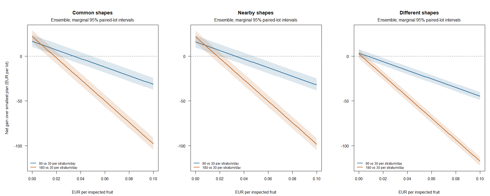

# How much are additional inspections worth?

200 independent base lots, three shape regimes, and three fixed inspection plans.
Plans inspect 30, 90 or 180 fruit per stratum on days 3/6/9/12:
240, 720 or 1,440 inspections per lot. All plans share inventory, prices,
training uniforms and future outcomes. Inspection calibration is known (Se=Sp=0.9).

Models and decision rules are fixed before the study. The ensemble averages
separate/shared-shape predictions using training-only AIC weights.
The standalone separate and shared models are also evaluated.

## Ensemble prediction and economic performance

Sale return is EUR after storage and delivery rejection, before inspection charges.
Net advantage subtracts all inspection charges and compares with day-12 immediate
sale, which requires no inspections. EUR 0.02 per check is hypothetical, not a market estimate.

| Shape regime | Checks per stratum/day | Total checks | Brier | Log loss | Sale return | Net advantage at EUR 0.02/check | Below immediate at EUR 0.02/check |
|---|---:|---:|---:|---:|---:|---:|---:|
| common_shape | 30 | 240 | 0.2616 | 1.1101 | 474.46 | -17.55 | 82.5% |
| common_shape | 90 | 720 | 0.2286 | 0.6795 | 490.96 | -10.65 | 80.5% |
| common_shape | 180 | 1440 | 0.2162 | 0.6297 | 496.46 | -19.55 | 83.5% |
| different_shapes | 30 | 240 | 0.1948 | 0.6633 | 532.02 | +27.08 | 63.0% |
| different_shapes | 90 | 720 | 0.1886 | 0.6117 | 535.38 | +20.84 | 61.5% |
| different_shapes | 180 | 1440 | 0.1880 | 0.5992 | 534.62 | +5.68 | 65.5% |
| nearby_shapes | 30 | 240 | 0.2702 | 1.1832 | 467.96 | -18.94 | 85.0% |
| nearby_shapes | 90 | 720 | 0.2362 | 0.7041 | 483.83 | -12.67 | 84.5% |
| nearby_shapes | 180 | 1440 | 0.2203 | 0.6392 | 489.58 | -21.32 | 87.0% |

## Paired benefit and break-even inspection price

Each row compares a larger plan with 30 checks per stratum/day, under the same model.
Gain excludes inspection charges. Break-even EUR per extra check is mean gain
divided by the additional number of checks (480 or 1,200). Intervals are marginal
95% paired whole-lot bootstrap intervals; negative thresholds are retained.

| Regime | Model | Larger plan | Sale-return gain [95% CI] | Break-even EUR/check [95% CI] |
|---|---|---:|---:|---:|
| common_shape | separate | 90 | +13.92 [+7.95, +21.04] | 0.0290 [0.0166, 0.0438] |
| different_shapes | separate | 90 | -0.26 [-7.15, +6.63] | -0.0005 [-0.0149, 0.0138] |
| nearby_shapes | separate | 90 | +18.00 [+11.93, +25.37] | 0.0375 [0.0249, 0.0529] |
| common_shape | separate | 180 | +19.63 [+12.71, +26.72] | 0.0164 [0.0106, 0.0223] |
| different_shapes | separate | 180 | +3.05 [-4.25, +9.53] | 0.0025 [-0.0035, 0.0079] |
| nearby_shapes | separate | 180 | +26.05 [+18.92, +33.86] | 0.0217 [0.0158, 0.0282] |
| common_shape | shared | 90 | +13.98 [+8.40, +19.53] | 0.0291 [0.0175, 0.0407] |
| different_shapes | shared | 90 | -3.51 [-7.60, -0.19] | -0.0073 [-0.0158, -0.0004] |
| nearby_shapes | shared | 90 | +15.99 [+9.76, +22.56] | 0.0333 [0.0203, 0.0470] |
| common_shape | shared | 180 | +20.43 [+14.31, +26.72] | 0.0170 [0.0119, 0.0223] |
| different_shapes | shared | 180 | -8.02 [-14.24, -2.73] | -0.0067 [-0.0119, -0.0023] |
| nearby_shapes | shared | 180 | +20.91 [+14.50, +28.26] | 0.0174 [0.0121, 0.0235] |
| common_shape | ensemble | 90 | +16.50 [+10.43, +23.66] | 0.0344 [0.0217, 0.0493] |
| different_shapes | ensemble | 90 | +3.36 [-0.90, +7.76] | 0.0070 [-0.0019, 0.0162] |
| nearby_shapes | ensemble | 90 | +15.87 [+9.67, +22.92] | 0.0331 [0.0202, 0.0478] |
| common_shape | ensemble | 180 | +22.00 [+15.55, +28.90] | 0.0183 [0.0130, 0.0241] |
| different_shapes | ensemble | 180 | +2.60 [-2.34, +7.50] | 0.0022 [-0.0019, 0.0063] |
| nearby_shapes | ensemble | 180 | +21.62 [+15.19, +28.32] | 0.0180 [0.0127, 0.0236] |



## Interpretation and limits

Larger plans improve mean ensemble Brier in 6 of 6 comparisons with the smallest plan.
Their mean sale-return gain is positive in 6 of 6 comparisons; at EUR 0.02/check,
2 of 6 mean gains remain positive after the extra inspection charges.
A lower prediction error need not yield enough economic benefit to pay for more data.

Thresholds concern these fixed policies and simulated lot distributions, not the
optimal value of information or an empirically recommended budget. A negative
threshold means the larger plan has a lower mean return even when checks are free.
Intervals describe mean differences across simulated lots, not an individual lot's payoff.

Inspection charges are incurred before the decision cutoff: they matter when
planning a study, but are sunk and constant across sale dates within a chosen plan.
The synthetic model assumes nondestructive inspections with no effect on fruit
survival or inventory, independent binomial observations, known calibration and
known future prices. Destructive sampling, handling damage and fixed visit costs
are excluded. Calibration-reference and holdout evaluation costs are also excluded.

Common inverse-CDF uniforms couple plans for Monte Carlo precision; larger plans
are not constructed by adding observations to an actual smaller pilot sample.
Each scenario has independent base lots; the paired scenarios/plans must not be
pooled as independent replicates. Intervals have no multiplicity adjustment.
No plan or model is selected using the reported future outcomes.

```sh
Rscript scripts/run_inspection_budget.R 200
```

[Records](records.csv), [cost summaries](summary.csv), [paired contrasts](contrasts.csv)
and [settings](settings.R) preserve all three models and all declared unit costs.
See [INSPECTION_BUDGET.md](../../INSPECTION_BUDGET.md) for the estimands and protocol.
