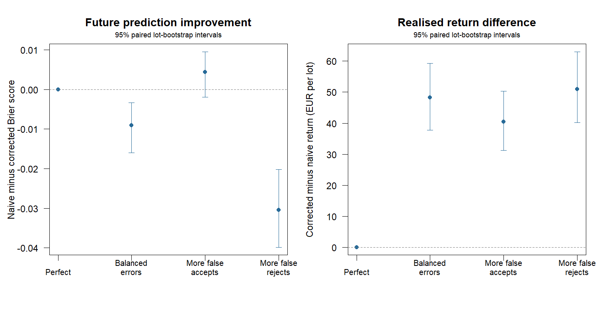

# Correcting inspection errors: synthetic evaluation

200 independent lots; naive and corrected fits see the same noisy training labels.
The corrected fit is supplied the true sensitivity and specificity as if
known from external calibration. These are assumed rates, not measured data.
Gold-standard future inspections and fruit outcomes are shared by all policies.

## Future prediction quality

Brier and log loss score true acceptance, not reported labels. Lower is better.
Brier improvement is naive minus corrected, with a paired lot-bootstrap interval.

| Scenario | Sensitivity | Specificity | Naive Brier | Corrected Brier | Brier improvement [95% CI] | Naive log loss | Corrected log loss |
|---|---:|---:|---:|---:|---:|---:|---:|
| perfect | 1.00 | 1.00 | 0.2036 | 0.2036 | +0.0000 [+0.0000, +0.0000] | 0.5971 | 0.5971 |
| balanced_errors | 0.90 | 0.90 | 0.2181 | 0.2271 | -0.0090 [-0.0160, -0.0033] | 0.6271 | 0.7158 |
| more_false_accepts | 0.95 | 0.80 | 0.2258 | 0.2213 | +0.0044 [-0.0019, +0.0095] | 0.6468 | 0.6758 |
| more_false_rejects | 0.80 | 0.95 | 0.2142 | 0.2447 | -0.0305 [-0.0399, -0.0202] | 0.6190 | 1.0601 |

## Mean realised net return per initially eligible 850-kg lot

Values are EUR after storage and delivery rejection. Economic improvements
are measured separately from predictive improvements.

| Scenario | Naive | Corrected | Immediate | Corrected - naive [95% CI] | Corrected - immediate [95% CI] |
|---|---:|---:|---:|---:|---:|
| perfect | 494.99 | 494.99 | 485.74 | +0.00 [+0.00, +0.00] | +9.25 [+4.41, +13.61] |
| balanced_errors | 437.54 | 485.86 | 485.74 | +48.32 [+37.74, +59.24] | +0.12 [-5.44, +5.02] |
| more_false_accepts | 445.17 | 485.64 | 485.74 | +40.47 [+31.17, +50.34] | -0.10 [-5.49, +5.33] |
| more_false_rejects | 430.80 | 481.79 | 485.74 | +50.99 [+40.24, +63.04] | -3.95 [-9.20, +1.66] |

## Decisions and descriptive downside

Strict underperformance excludes exact ties. Fractions are descriptive.

| Scenario | Naive mean sale day | Corrected mean sale day | Different dates | Naive below immediate | Corrected below immediate |
|---|---:|---:|---:|---:|---:|
| perfect | 14.92 | 14.92 | 0.0% | 9.0% | 9.0% |
| balanced_errors | 21.69 | 15.11 | 47.5% | 48.5% | 12.0% |
| more_false_accepts | 21.10 | 15.27 | 47.5% | 48.5% | 13.5% |
| more_false_rejects | 22.18 | 15.46 | 46.5% | 51.0% | 15.5% |



## Interpretation and reproduction

Correction increases mean returns versus naive fitting in 3 of 3 noisy scenarios,
but worsens mean future Brier scores in 2 and mean log loss in 3 of them.
Corrected-minus-immediate return intervals include zero in 3 of 3 noisy scenarios.
Short, noisy training histories can yield unstable survival extrapolations
even under a correctly specified measurement model. Fixed calibration does
not restore information lost through misclassification.

Intervals are marginal and do not adjust for multiple comparisons. The
correction assumes exact, stable calibration rates shared by strata/days.
Calibration uncertainty, correlated inspection mistakes and imperfect future
reference labels are not simulated. Weibull deterioration and perfectly known
prices remain assumptions. These results do not establish field profitability.

From the project folder:

```sh
Rscript scripts/run_inspection_error.R 200
```

[records.csv](records.csv), [summary.csv](summary.csv) and [settings.R](settings.R)
contain paired measurements, all metrics and reproduction settings.
See [INSPECTION_ERROR.md](../../INSPECTION_ERROR.md) for the likelihood and protocol.
