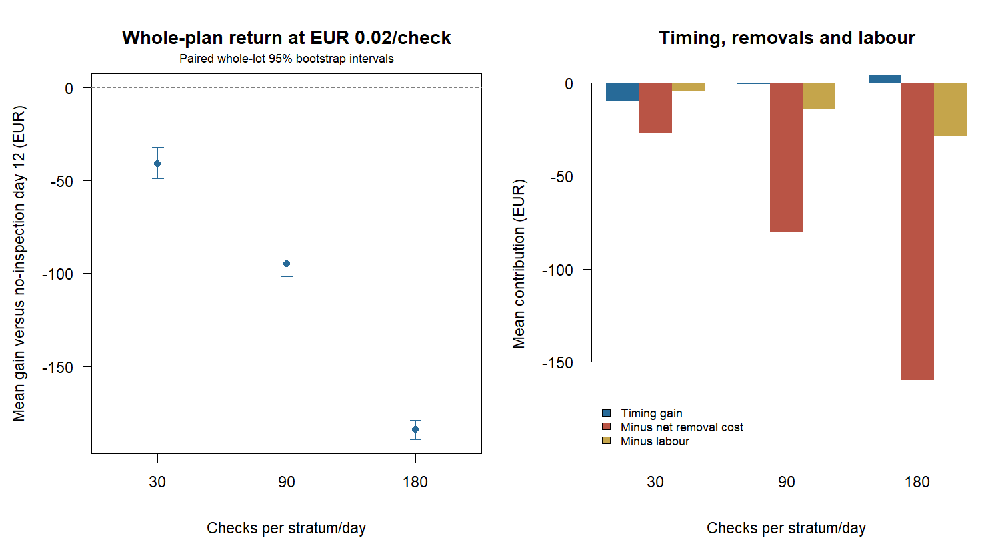

# Does destructive inspection pay for itself?

200 fresh independent synthetic lots, three prespecified plans, and the same finite fruit population for all alternatives.
Every lot starts with 850 kg of eligible fruit (4,250 fruit at 0.20 kg).
Plans inspect 30, 90 or 180 fruit per stratum on days 3/6/9/12, removing
48, 144 or 288 kg respectively. Every inspected fruit is destroyed, regardless
of its reported quality. No-inspection comparators retain the full inventory.

Inspection-driven dates use the same fixed AIC-mixture policy on remaining
inventory. Benchmarks sell without inspection on prespecified days 12 or 16.
All returns include physical holding costs from harvest through delivery,
including savings from earlier removals. Sale before day 12 is outside this study.

## Returns at hypothetical EUR 0.02 per check

Mean no-inspection returns are EUR 475.50 at day 12 and EUR 455.89 at day 16.

| Checks/stratum/day | Total checks | Mean sale day | Mean net EUR | Gain vs no-inspection day 12 [95% CI] | Gain vs no-inspection day 16 [95% CI] | Below day 12 / day 16 |
|---|---:|---:|---:|---:|---:|---:|
| 30 | 240 | 16.57 | 434.40 | -41.09 [-49.17, -32.25] | -21.49 [-32.20, -11.67] | 89.0% / 55.0% |
| 90 | 720 | 15.64 | 380.42 | -95.07 [-101.63, -88.59] | -75.47 [-84.20, -66.81] | 96.5% / 86.5% |
| 180 | 1440 | 15.27 | 291.19 | -184.30 [-189.63, -179.29] | -164.70 [-173.28, -156.48] | 99.5% / 100.0% |

## Where the difference comes from

The following identity holds for every lot: gain versus no-inspection day 12
equals the timing gain on remaining fruit minus net removal cost minus labour.
Timing gain compares the chosen date with day 12 after the same removals.
Net removal cost is the removed fruit's forgone day-12 sale revenue, less its
saved holding cost through delivery. It can be negative and is never clipped.

| Checks/stratum/day | Timing gain EUR | Net removal cost EUR | Labour EUR | Total gain EUR |
|---|---:|---:|---:|---:|
| 30 | -9.57 | 26.72 | 4.80 | -41.09 |
| 90 | -0.67 | 80.01 | 14.40 | -95.07 |
| 180 | +4.00 | 159.50 | 28.80 | -184.30 |

## Labour sensitivity and break-even charges

Policies and fruit outcomes stay fixed at every labour price. The break-even
charge is the mean gain before labour divided by the number of checks.
A negative value means free labour still fails to cover the net removal cost
relative to day-12 sale without inspection; it is not a feasible positive price.

| Checks/stratum/day | Gain with free labour EUR [95% CI] | Break-even EUR/check [95% CI] |
|---|---:|---:|
| 30 | -36.29 [-44.37, -27.45] | -0.1512 [-0.1849, -0.1144] |
| 90 | -80.67 [-87.23, -74.19] | -0.1120 [-0.1212, -0.1030] |
| 180 | -155.50 [-160.83, -150.49] | -0.1080 [-0.1117, -0.1045] |



## Interpretation and reproduction

These are paired policy comparisons under one synthetic nearby-shape regime,
not an estimate of the optimal value of information. Random sample IDs are
disjoint across days and nested across plans. Hidden lifetimes supply only
pre-cutoff inspection labels to fitting; raw IDs, future outcomes and true
parameters never enter policy fitting. Evaluation uses actual uninspected fruit.

Intervals resample independent whole lots, not fruit or the three correlated
plan records as independent observations. They are marginal percentile 95%
intervals without multiple-comparison adjustment. Costs and sample plans were
fixed before outcomes; no winning plan is selected on these evaluation lots.

Known prices and grading accuracy, independent equal-mass fruit, no handling
damage or disposal value, fixed inspection days and fixed sale benchmarks limit
interpretation. Historical-data policies, earlier sales, other inspection
designs and empirically measured costs could change the comparison.

```sh
Rscript scripts/run_inspection_plan_value.R 200
```

[Records](records.csv), [summary](summary.csv), [settings](settings.R),
and [protocol](../../INSPECTION_PLAN_VALUE.md) preserve the assumptions and results.
