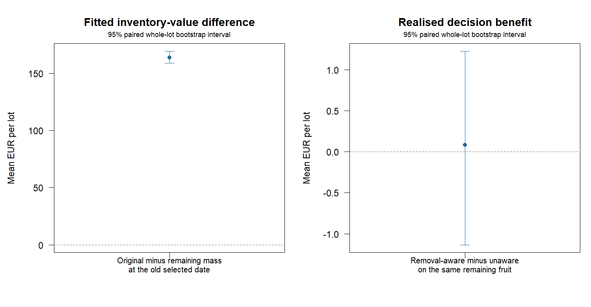

# Destructive inspections: valuing the fruit that remains

200 fresh independent synthetic lots; one fixed inspection plan and identical survival fits for both decisions.
Each lot starts with 850 kg of eligible fruit. Inspecting and removing 180 fruit
per stratum on four days removes 1,440 fruit at 0.20 kg each: 288 kg in total.
The day-12 remaining eligible inventory is 562 kg. No removed fruit can be sold.

The inventory-unaware rule chooses a date using the original masses. The
removal-aware rule uses the observed ledger and charges future holding costs
only on remaining mass. Both use the same fitted AIC-weighted survival mixture.
All decisions are fixed before generating the remaining fruit's outcomes.

## Forecast accounting versus decision benefit

The first contrast holds the old sale date and fitted curves fixed, changing only
the inventory ledger. The second reoptimises the date on the corrected fitted curve.
Neither contrast is itself a realised profit improvement.

| Contrast | Mean EUR per lot [95% paired-lot CI] |
|---|---:|
| Original-mass minus remaining-mass fitted value at the old date | +163.76 [+158.97, +169.32] |
| Fitted gain from reoptimising after removals | +0.30 [+0.16, +0.46] |
| True expected gain from the changed date | +0.03 [-1.20, +1.07] |
| Realised removal-aware minus inventory-unaware return | +0.08 [-1.14, +1.23] |

True expected values use inaccessible generating survival curves on the actual
remaining inventory, only for evaluation. Policies never receive those parameters.

## Actual remaining-inventory returns

All returns include delivery rejection, post-cutoff holding cost and EUR 28.80
of already-incurred inspection labour (hypothetical EUR 0.02 per check).
Immediate sale also follows the same completed destructive inspections.

| Policy | Mean sale day | Mean realised EUR | Below immediate sale |
|---|---:|---:|---:|
| Inventory-unaware | 14.72 | 297.74 | 8.5% |
| Removal-aware | 15.00 | 297.82 | 7.5% |
| Immediate after inspection | 12.00 | 291.53 | -- |

Accounting for removals changes 16.5% of sale dates; the corrected decision earns less than the unaware decision on 4.0% of lots.
Its mean realised advantage over immediate sale is EUR +6.29 [1.67, 11.07].



## Interpretation and reproduction

A corrected inventory value is not an equal-sized profit gain. Decisions can
remain unchanged, and fitting error can make a revised date worse on some lots.
This study isolates decisions after a fixed inspection plan. It does not compare
destructive versus nondestructive plans or establish the value of inspections.

Removed samples are random within each initial stratum, independent of fruit
survival and mass. Remaining fruit can already be unacceptable; this is not
selective culling or conditioning survival on passing a day-12 inspection.
No inspection damage to the remainder, disposal revenue/cost, calibration
uncertainty, shared storage shocks or price errors are modeled. Marginal
bootstrap intervals are not adjusted for multiple contrasts; downside fractions
use all lots as the denominator and count strictly lower returns. Synthetic
results are not evidence of field profitability.

```sh
Rscript scripts/run_inspection_removals.R 200
```

[Records](records.csv), [summary](summary.csv) and [settings](settings.R) preserve the results.
See [INSPECTION_REMOVALS.md](../../INSPECTION_REMOVALS.md) for the ledger contract and protocol.
