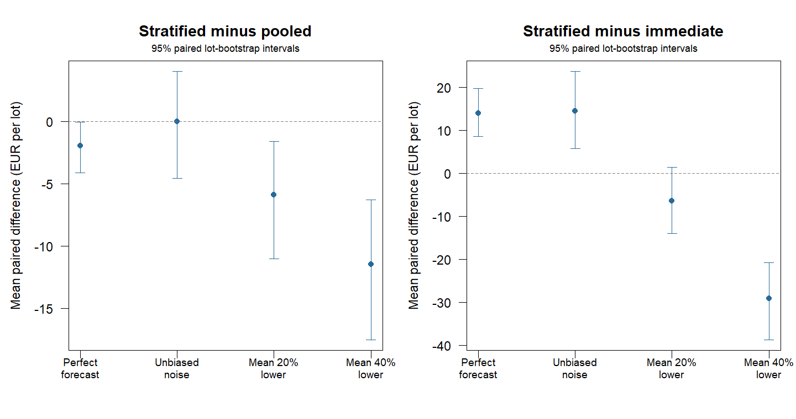

# Price forecast sensitivity: synthetic results

200 independent lots; decisions fixed at day 12 from forecast prices.
All scenarios share lots, fruit lifetimes and forecast-based sale dates.
Price multipliers are shared across grades; the day-12 price is known.
The perfect-forecast row uses the original evaluation's seeded lots.

## Realised net return per initially eligible 850-kg lot

All values are EUR. Intervals resample paired lots and describe uncertainty
in mean policy contrasts under this synthetic generator, not field validity.

| Price scenario | Stratified | Pooled | Immediate | Stratified - pooled [95% CI] | Stratified - immediate [95% CI] |
|---|---:|---:|---:|---:|---:|
| perfect_forecast | 500.46 | 502.41 | 486.51 | -1.96 [-4.12, -0.02] | +13.95 [+8.57, +19.74] |
| unbiased_noise | 501.05 | 501.04 | 486.51 | +0.01 [-4.56, +4.02] | +14.54 [+5.74, +23.69] |
| mean_20pct_lower | 480.08 | 485.95 | 486.51 | -5.87 [-11.02, -1.58] | -6.43 [-14.02, +1.45] |
| mean_40pct_lower | 457.36 | 468.81 | 486.51 | -11.45 [-17.53, -6.31] | -29.15 [-38.76, -20.84] |

## Downside and price-error impact

Fractions and 10th percentiles are descriptive sample summaries. Exact ties
are not counted as underperformance. Price impact compares the same policy
on the same lot with its perfect-forecast realised return.

| Scenario | Stratified below immediate | Pooled below immediate | 10th percentile: stratified - immediate, EUR | Mean price impact on stratified, EUR |
|---|---:|---:|---:|---:|
| perfect_forecast | 8.5% | 5.0% | +0.00 | +0.00 |
| unbiased_noise | 13.0% | 13.5% | -19.89 | +0.59 |
| mean_20pct_lower | 22.0% | 19.5% | -56.64 | -20.38 |
| mean_40pct_lower | 33.0% | 26.5% | -114.80 | -43.10 |



## Interpretation and reproduction

Unbiased noise changes dispersion without changing conditional mean prices.
The lower-mean scenarios gradually lower expected realised prices to 80% or
60% of forecast at day 28, with terminal log-error SD 0.2. These settings
are sensitivity assumptions, not estimates of orange-market forecast errors.
The policies are not adapted or chosen using these results. No oracle is
reported: the original forecast-informed oracle need not be optimal under
a biased realised price process. Shared grade shocks, independent lots and
Weibull deterioration remain restrictive assumptions.

From the project folder:

```sh
Rscript scripts/run_price_sensitivity.R 200
```

[records.csv](records.csv) contains paired lot/scenario measurements;
[summary.csv](summary.csv) contains all contrasts and descriptive risks;
[settings.R](settings.R) records seeds, scenarios, bootstrap count and R version.
See [the study design](../../PRICE_SENSITIVITY.md) for the price process and limitations.
