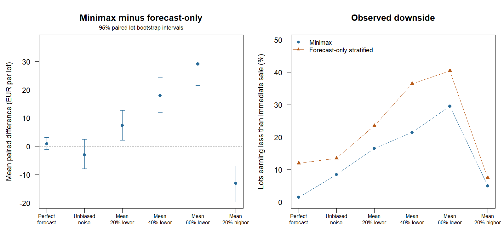

# Minimax-regret policy: fresh synthetic evaluation

200 independent lots; one sale date fixed at day 12 for each policy.
The minimax policy considers terminal mean price ratios {0.6, 0.8, 1.0}.
It minimises the largest fitted expected shortfall against each mean path's
best sale date. All decisions precede held-out outcomes and price errors.
The rule was motivated by the earlier price study; these lots and price
innovations use fresh seeds, with no tuning to the evaluation results.

Mean sale day: minimax 13.37; forecast-only stratified 14.90.
Minimax sells earlier than forecast-only on 44.0% of lots.

## Mean realised net return per initially eligible 850-kg lot

All returns are EUR, after storage and delivery rejection.

| Evaluation scenario | Minimax | Forecast-only stratified | Pooled | Immediate |
|---|---:|---:|---:|---:|
| perfect_forecast | 500.64 | 499.75 | 501.09 | 485.12 |
| unbiased_noise | 498.48 | 501.46 | 500.40 | 485.12 |
| mean_20pct_lower | 488.20 | 480.87 | 486.27 | 485.12 |
| mean_40pct_lower | 476.37 | 458.41 | 470.06 | 485.12 |
| mean_60pct_lower | 461.94 | 432.87 | 450.40 | 485.12 |
| mean_20pct_higher | 507.69 | 520.77 | 513.10 | 485.12 |

## Paired mean differences [95% lot-bootstrap interval]

Intervals are marginal, without multiple-comparison adjustment. They describe
mean contrasts under this generator, not individual-lot protection or field validity.

| Scenario | Minimax - forecast-only | Minimax - pooled | Minimax - immediate |
|---|---:|---:|---:|
| perfect_forecast | +0.88 [-1.08, +3.14] | -0.45 [-2.20, +1.37] | +15.52 [+10.70, +20.82] |
| unbiased_noise | -2.98 [-7.89, +2.43] | -1.92 [-5.38, +1.72] | +13.36 [+7.89, +20.04] |
| mean_20pct_lower | +7.34 [+2.18, +12.72] | +1.93 [-1.82, +5.99] | +3.09 [-1.27, +7.87] |
| mean_40pct_lower | +17.96 [+11.99, +24.41] | +6.31 [+2.40, +10.41] | -8.75 [-13.52, -4.00] |
| mean_60pct_lower | +29.07 [+21.54, +37.19] | +11.54 [+6.19, +16.56] | -23.17 [-30.77, -16.55] |
| mean_20pct_higher | -13.08 [-19.70, -7.03] | -5.41 [-9.76, -1.18] | +22.57 [+14.60, +30.67] |

## Descriptive downside against immediate sale

Strict underperformance excludes exact ties; percentiles are empirical, not intervals.

| Scenario | Minimax below immediate | Forecast-only below immediate | Minimax difference p10, EUR | Forecast-only difference p10, EUR |
|---|---:|---:|---:|---:|
| perfect_forecast | 1.5% | 12.0% | +0.00 | -1.14 |
| unbiased_noise | 8.5% | 13.5% | +0.00 | -10.64 |
| mean_20pct_lower | 16.5% | 23.5% | -18.06 | -48.45 |
| mean_40pct_lower | 21.5% | 36.5% | -44.51 | -93.59 |
| mean_60pct_lower | 29.5% | 40.5% | -87.38 | -188.86 |
| mean_20pct_higher | 5.0% | 7.5% | +0.00 | +0.00 |



## Interpretation and reproduction

The 60%-lower and 20%-higher terminal means lie outside the decision set.
Even for a mean inside that set, random realised paths can lie outside it.
Minimax regret bounds only fitted expected regret on the declared finite
set: it does not guarantee a profit, beat immediate sale, or control a tail
probability. The scenarios are assumptions, not calibrated market forecasts.
All policies share each lot's inspections, fruit outcomes and price errors.
Weibull deterioration, independent lots and shared grade shocks remain assumptions.

From the project directory:

```sh
Rscript scripts/run_robust_policy.R 200
```

[records.csv](records.csv), [summary.csv](summary.csv) and [settings.R](settings.R)
provide paired outcomes, all metrics and the reproduction settings.
See [ROBUST_POLICY.md](../../ROBUST_POLICY.md) for the criterion and limitations.
