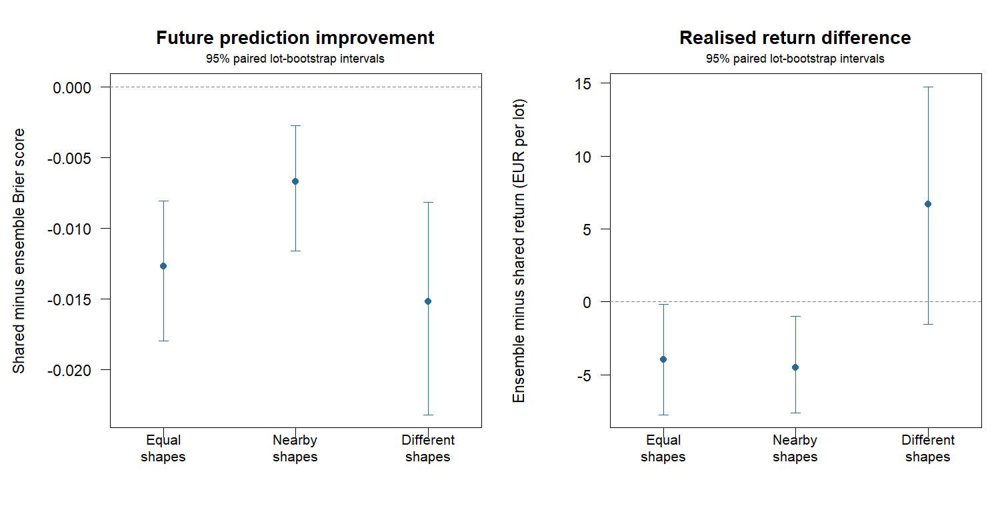

# Averaging separate and shared Weibull shapes: synthetic comparison

200 independent base lots, each evaluated under three paired generating scenarios.
Weights use AIC from the same noisy day-3/6/9/12 inspections, with exact
90% sensitivity/specificity. The mixture averages survival probabilities
and selects the earliest maximum of its expected net-value curve.
All weights and sale dates are fixed before future outcomes are generated.

Separate component fits retry from feasible shared-shape solutions when needed.
The separate benchmark uses those same refined fits; previous studies are unchanged.

## Training weights and future prediction quality

Lower Brier and log loss are better. Weights are descriptive model weights,
not calibrated probabilities that a generating model is true.

| Scenario | Mean shared weight | Separate Brier | Shared Brier | Ensemble Brier | Separate log loss | Shared log loss | Ensemble log loss |
|---|---:|---:|---:|---:|---:|---:|---:|
| common_shape | 0.625 | 0.2411 | 0.1987 | 0.2114 | 1.0844 | 0.5926 | 0.6267 |
| nearby_shapes | 0.608 | 0.2338 | 0.2086 | 0.2153 | 0.9500 | 0.6099 | 0.6327 |
| different_shapes | 0.624 | 0.2471 | 0.1665 | 0.1817 | 1.9086 | 0.5531 | 0.5854 |

## Realised return per initially eligible 850-kg lot

Returns are EUR after storage and delivery rejection, under perfectly known prices.

| Scenario | Separate | Shared | Ensemble | Immediate |
|---|---:|---:|---:|---:|
| common_shape | 485.63 | 498.18 | 494.25 | 485.10 |
| nearby_shapes | 477.38 | 490.48 | 485.99 | 480.16 |
| different_shapes | 530.13 | 527.40 | 534.11 | 498.88 |

Paired mean differences with marginal 95% whole-lot bootstrap intervals:

| Scenario | Ensemble - separate | Ensemble - shared | Ensemble - immediate |
|---|---:|---:|---:|
| common_shape | +8.62 [+4.09, +13.66] | -3.93 [-7.74, -0.18] | +9.15 [+1.71, +17.16] |
| nearby_shapes | +8.61 [+4.91, +12.72] | -4.49 [-7.61, -1.00] | +5.83 [-0.29, +12.80] |
| different_shapes | +3.98 [-2.72, +11.36] | +6.71 [-1.54, +14.76] | +35.23 [+17.83, +52.60] |

## Decisions and descriptive downside

Fractions use all lots as the denominator; only strictly lower returns count as losses.

| Scenario | Separate mean day | Shared mean day | Ensemble mean day | Separate below immediate | Shared below immediate | Ensemble below immediate |
|---|---:|---:|---:|---:|---:|---:|
| common_shape | 16.28 | 16.00 | 16.02 | 17.5% | 14.5% | 14.5% |
| nearby_shapes | 16.30 | 15.02 | 15.43 | 20.0% | 12.5% | 15.5% |
| different_shapes | 19.59 | 23.68 | 21.32 | 18.5% | 31.0% | 21.5% |



## Interpretation and reproduction

The ensemble has lower mean Brier scores than separate fits in 3 of 3 regimes,
and lower scores than shared shape in 0 of 3 regimes.
With different shapes, its return difference from shared shape is EUR +6.71 [-1.54, 14.76],
and observed underperformance against immediate sale is 21.5%, versus 31.0% for shared and 18.5% for separate fits.
Better average prediction does not guarantee better decisions or lower downside.

AIC weights are fixed from the training likelihood, not tuned on future scores.
Short histories, weak identification and bounded optimisation limit the usual
AIC approximation. Averaging does not guarantee improvement over either component.
Intervals are marginal without multiplicity adjustment; downside is descriptive.
The three regimes share base lots and are not pooled as independent observations.

Exact calibration, independent inspections, Weibull deterioration within strata,
negligible sampling removals and known prices are assumptions. Calibration
uncertainty and storage shocks are not combined here. These synthetic results
do not establish field profitability or empirical model validity.

```sh
Rscript scripts/run_shape_ensemble.R 200
```

[Paired records](records.csv), [summary](summary.csv) and [settings](settings.R)
preserve all component comparisons, training likelihoods and model weights.
See [SHAPE_ENSEMBLE.md](../../SHAPE_ENSEMBLE.md) for the model and protocol.
