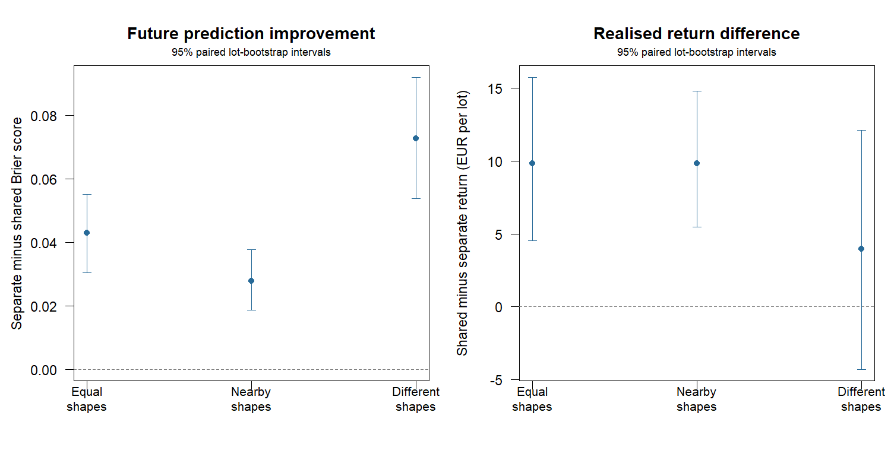

# Sharing Weibull shape across fruit strata: synthetic comparison

200 independent lots per scenario, paired across fitted models and generating scenarios.
Both fits receive the same noisy day-3/6/9/12 inspections and exact 90%
sensitivity/specificity. Future scores use gold-standard inspections.
Shared shape retains separate stratum scales; separate fitting estimates both
parameters independently. All decisions precede future outcome generation.

## Future prediction quality

Lower scores are better. Improvement is separate minus shared; intervals are
paired whole-lot bootstrap intervals for mean differences.

| Generating scenario | Separate Brier | Shared Brier | Improvement [95% CI] | Separate log loss | Shared log loss |
|---|---:|---:|---:|---:|---:|
| common_shape | 0.2408 | 0.1978 | +0.0430 [+0.0304, +0.0552] | 1.0997 | 0.5861 |
| nearby_shapes | 0.2368 | 0.2089 | +0.0279 [+0.0186, +0.0377] | 0.9265 | 0.6096 |
| different_shapes | 0.2359 | 0.1632 | +0.0727 [+0.0540, +0.0921] | 1.7718 | 0.5441 |

## Realised return per initially eligible 850-kg lot

Returns are EUR after storage and delivery rejection, under perfectly known prices.

| Scenario | Separate | Shared | Immediate | Shared - separate [95% CI] | Shared - immediate [95% CI] |
|---|---:|---:|---:|---:|---:|
| common_shape | 488.47 | 498.28 | 490.49 | +9.81 [+4.53, +15.75] | +7.79 [+2.27, +13.20] |
| nearby_shapes | 481.16 | 490.97 | 485.15 | +9.82 [+5.46, +14.78] | +5.82 [+1.77, +10.18] |
| different_shapes | 530.23 | 534.20 | 505.71 | +3.97 [-4.29, +12.10] | +28.49 [+13.11, +44.35] |

## Decisions and descriptive downside

| Scenario | Separate mean day | Shared mean day | Different dates | Separate below immediate | Shared below immediate |
|---|---:|---:|---:|---:|---:|
| common_shape | 16.39 | 15.93 | 44.0% | 18.5% | 18.5% |
| nearby_shapes | 16.20 | 14.74 | 36.5% | 20.5% | 15.5% |
| different_shapes | 20.05 | 23.36 | 30.5% | 21.5% | 29.5% |



## Interpretation and reproduction

Shared shape improves mean Brier scores in 3 of 3 regimes.
With different shapes, its return difference is EUR +3.97 [-4.29, 12.10],
and observed underperformance against immediate sale is 29.5% versus 21.5% for separate fits.
Prediction quality and the economic consequences of a chosen date are distinct.

A common shape imposes a structural restriction. It can reduce estimation
variation but introduce bias when strata have different deterioration shapes.
This comparison does not select a model using the future scores. Negative
effects are retained, including under the deliberately different-shape regime.

Intervals are marginal without multiplicity adjustment. Downside fractions are
descriptive and exclude ties. Exact calibration, independent samples, Weibull
deterioration, negligible inspection removals and known prices are assumptions.
Calibration uncertainty and storage shocks are not combined with this experiment.
Synthetic comparisons do not establish field profitability or model validity.

```sh
Rscript scripts/run_shared_shape.R 200
```

[Paired records](records.csv), [summary](summary.csv) and [settings](settings.R)
preserve the results. See [SHARED_SHAPE.md](../../SHARED_SHAPE.md) for the model and protocol.
