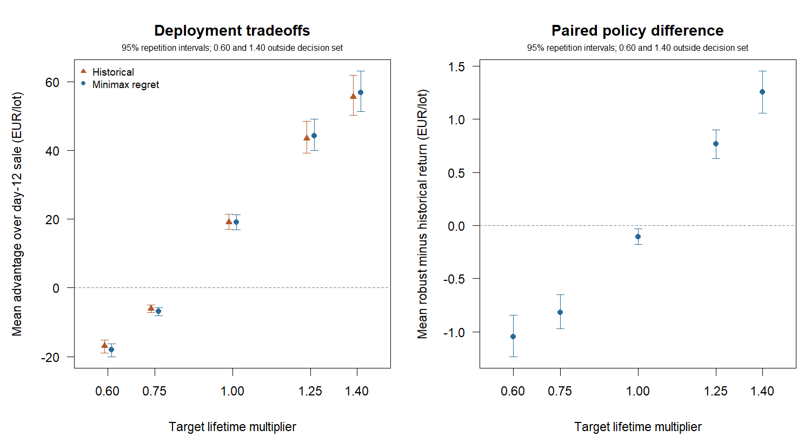

# Minimax regret for uncertain target shelf life

30 independent repetitions, each with 100 historical lots and 50 fresh target lots.
The historical rule optimises its fitted survival curves. The robust rule
minimises worst fitted regret over lifetime multipliers 0.75, 1 and 1.25.
Regret is the loss relative to the best fitted date within each scenario.
Both rules use the same frozen model, initial masses and supplied price path.
All dates precede target fruit outcomes; neither rule knows the realised shift.

There are 1500 unique target lots and 7500 paired target/scenario records.
Multipliers 0.60 and 1.40 lie outside the decision set. Evaluation scenarios
share each target's fruit identities, masses and prices. Scenarios have no
assigned probabilities and are not averaged into an overall performance score.

## Paired deployment returns

EUR per target lot, mean [marginal 95% percentile interval]. Intervals resample
whole independent train/test repetitions and preserve all policy/scenario pairs.

| Target lifetime factor | In decision set? | Robust minus historical | Historical minus day 12 | Robust minus day 12 |
|---|---|---:|---:|---:|
| 0.60 | No | -1.05 [-1.24, -0.84] | -16.96 [-18.97, -15.22] | -18.01 [-20.10, -16.25] |
| 0.75 | Yes | -0.82 [-0.97, -0.65] | -6.06 [-7.23, -4.94] | -6.88 [-8.12, -5.70] |
| 1.00 | Yes | -0.10 [-0.18, -0.03] | 19.14 [17.07, 21.41] | 19.04 [16.93, 21.30] |
| 1.25 | Yes | 0.77 [0.63, 0.90] | 43.51 [39.23, 48.45] | 44.28 [39.95, 49.19] |
| 1.40 | No | 1.26 [1.06, 1.45] | 55.56 [50.15, 61.84] | 56.82 [51.35, 63.10] |

## Strict-loss frequencies

Percent of target lots, mean [95% interval]. Ties are not losses.

| Target lifetime factor | Robust below historical (%) | Historical below day 12 (%) | Robust below day 12 (%) |
|---|---:|---:|---:|
| 0.60 | 9.53 [8.27, 10.80] | 42.13 [39.20, 45.47] | 46.47 [43.87, 49.40] |
| 0.75 | 9.47 [8.27, 10.73] | 35.53 [32.73, 38.53] | 40.13 [37.46, 42.93] |
| 1.00 | 6.33 [5.07, 7.67] | 5.40 [4.40, 6.47] | 8.20 [6.93, 9.40] |
| 1.25 | 1.13 [0.60, 1.73] | 0.00 [0.00, 0.00] | 0.20 [0.00, 0.47] |
| 1.40 | 0.87 [0.33, 1.47] | 0.00 [0.00, 0.00] | 0.07 [0.00, 0.20] |

## Fitted decision diagnostics

Mean sale day: historical 14.25, robust 14.34; dates differ on 10.5% of target lots.
Mean worst fitted regret across the decision set: historical EUR 11.41, robust EUR 11.02.
The robust date cannot have larger worst fitted regret than another candidate
date in its own model. That optimisation property is not an empirical return
guarantee. The model is a working marginal Weibull fit, rather than the true
survival curve of a particular target lot.



## Interpretation limits

Robust means minimax regret over a finite, declared model set. It does not
mean best realised return, smallest worst loss, a calibrated survival forecast
or a bound for every multiplier between the three decision values. The
outside-set scenarios test sensitivity beyond those assumptions. Outcomes
must be considered separately by scenario, including any losses in unchanged
or longer-lived populations. No policy or scenario set was tuned on these targets.

Every policy retains 850 kg of initially eligible fruit, with no target
inspection. Realised returns include holding from harvest through delivery
at EUR 0.001/kg/day and a two-day lag. Fitted decisions use future costs from
day 12; the common sunk holding cost cancels from fitted regret. Initially
immature fruit remain excluded. Archive acquisition, destructive sampling,
labour and development costs are not included.

History has six ages and 60 checks per stratum/age/lot, with known grading
sensitivity/specificity of 0.90. Initial grades and prices are assumed known.
Shifts multiply target lifetimes from harvest, equally across both eligible
strata, preserving Weibull shapes. Shared latent fruit ranks couple scenarios.
This remains synthetic evidence without field validation or shift probabilities.

The independent sample size is the repetition count. The 2,000 bootstrap
resamples include archive and finite-test-panel variation, using common
repetition indices across metrics and scenarios. Intervals concern expected
performance, are marginal without multiplicity adjustment, and do not predict
the next lot's return. Failed repetitions stop the study rather than being dropped.

## Reproduction

```sh
Rscript scripts/run_survival_regret.R 30 results/survival_regret 50
```

[Seeds](seeds.csv), [aggregate training counts](counts.csv), [fitted curves](fits.csv),
[paired target records](records.csv), [repetition means](repetitions.csv),
[intervals](summary.csv) and [settings](settings.R) preserve the calculations.
The seed manifest regenerates individual historical lots and target panels.
See [SURVIVAL_REGRET.md](../../SURVIVAL_REGRET.md) for the protocol and API.
