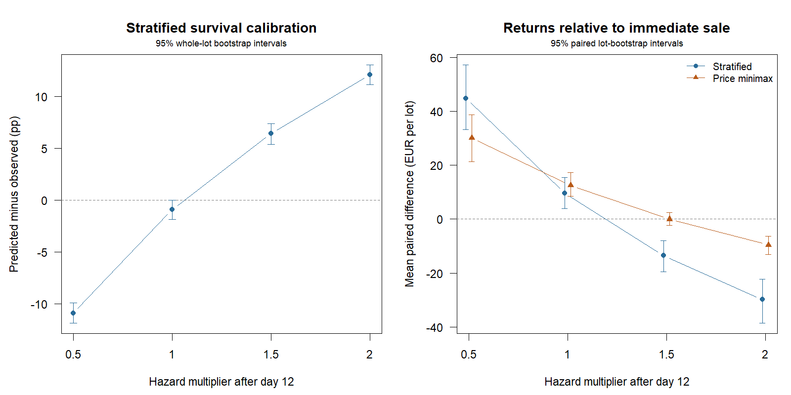

# Deterioration after the decision cutoff: synthetic results

200 independent lots; policies fitted and fixed before the day-12 hazard change.
Every scenario shares training inspections, sale dates, fruit identities and
future inspection uniforms. Realised prices equal the original forecast.
Immediate sale still faces deterioration before acceptance on day 14.

## Out-of-time prediction errors

Bias is predicted minus observed acceptable fraction, in percentage points,
standardised by inventory mass and averaged over future days and lots.
Positive bias means overprediction. Brier and log loss are individual-fruit
proper scores (lower is better); their levels also depend on prevalence.

| Scenario | Post-cutoff hazard factor | Stratified bias, pp [95% CI] | Pooled bias, pp | Stratified Brier | Pooled Brier | Stratified log loss | Pooled log loss |
|---|---:|---:|---:|---:|---:|---:|---:|
| unchanged | 1.0 | -0.92 [-1.85, +0.01] | -3.07 | 0.2048 | 0.2436 | 0.5994 | 0.6825 |
| slower | 0.5 | -10.91 [-11.87, -9.92] | -13.05 | 0.2170 | 0.2507 | 0.6362 | 0.6988 |
| faster | 1.5 | +6.42 [+5.39, +7.35] | +4.27 | 0.2031 | 0.2406 | 0.5917 | 0.6753 |
| double_hazard | 2.0 | +12.10 [+11.11, +13.03] | +9.95 | 0.2062 | 0.2395 | 0.5970 | 0.6724 |

## Mean realised net return per initially eligible 850-kg lot

All returns are EUR after storage and delivery rejection.

| Scenario | Stratified | Pooled | Price minimax | Immediate |
|---|---:|---:|---:|---:|
| unchanged | 492.43 | 495.00 | 495.25 | 482.75 |
| slower | 549.51 | 539.40 | 534.87 | 504.72 |
| faster | 448.91 | 458.33 | 462.37 | 462.39 |
| double_hazard | 413.55 | 427.39 | 433.82 | 443.40 |

## Paired differences against immediate sale

Mean differences have marginal 95% whole-lot bootstrap intervals.
Underperformance fractions are descriptive and exclude exact ties.

| Scenario | Stratified - immediate, EUR [95% CI] | Price minimax - immediate, EUR [95% CI] | Stratified below immediate | Price minimax below immediate |
|---|---:|---:|---:|---:|
| unchanged | +9.68 [+3.91, +15.38] | +12.49 [+8.58, +17.27] | 9.0% | 2.0% |
| slower | +44.78 [+33.18, +57.23] | +30.14 [+21.34, +38.67] | 1.0% | 0.0% |
| faster | -13.48 [-19.54, -8.00] | -0.03 [-2.34, +2.37] | 27.0% | 15.5% |
| double_hazard | -29.85 [-38.64, -22.33] | -9.57 [-13.11, -6.38] | 35.0% | 24.5% |



## Interpretation and reproduction

Hazard factors are sensitivity assumptions, not estimates from storage data.
The price-minimax rule considers a finite set of fitted mean-price scenarios;
it does not model this deterioration shift. No policy observes or adapts to it.
Reported intervals describe simulation uncertainty and are not adjusted for
multiple comparisons. Aggregate bias can conceal errors within grades/days;
cross-scenario proper-score changes also reflect changed outcome prevalence.
The unchanged scenario preserves baseline economic outcomes; holdout quality
counts are newly drawn with a separate seed and coupled across hazard settings.

From the project folder:

```sh
Rscript scripts/run_survival_stress.R 200
```

[records.csv](records.csv), [summary.csv](summary.csv), and [settings.R](settings.R)
contain paired lot measurements, all statistics (including pooled contrasts
and downside percentiles), and reproduction settings.
See [SURVIVAL_STRESS.md](../../SURVIVAL_STRESS.md) for the generator and limits.
